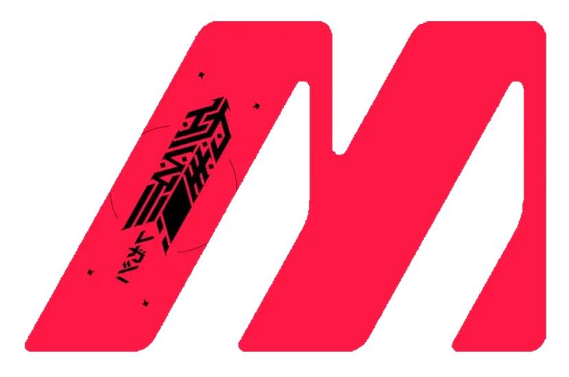

# Footers Pterodactyl <a href="README.md"></a> <a href="README_UA.md"></a> <a href="README_EN.md"></a>


## Description

**Footers Pterodactyl** is a ready-made footer in a pink brand style: glass background, interactive canvas particles, a typewriter effect, a live clock and built-in multilingual support.

Suitable for:

* web applications
* portfolios
* landing pages
* commercial websites

No bundlers or npm packages: include the files (or a single CDN snippet) and the footer works.

---

## Features

* Brand design with a glass effect and cut corners
* Custom particle system on `<canvas>` (no Particles.js) that reacts to the cursor
* Typewriter effect with rotating phrases
* Live clock (UTC+3) and network status indicator
* Automatic browser language detection (RU / UK / EN)
* Automatic detection of light and dark site backgrounds
* Optional background image
* Optional copy protection
* Fully responsive
* Support for `prefers-reduced-motion` and `prefers-contrast`
* Social icons and a "Multilink" button with hover effects

---

## Project structure

```text
Footers_Pterodactyl/
├── Index_footer.html       # local files setup
├── footer-panel.html       # CDN setup (jsDelivr, complete branch)
├── README.md               # documentation (RU)
├── README_UA.md            # documentation (UA)
├── README_EN.md            # documentation (EN)
└── assets/
    ├── logo.webp
    ├── images/
    │   └── picture.webp            # background image
    ├── icons/
    │   ├── icon-m-pink.webp
    │   ├── icon-m-white.webp
    │   └── icon-m-black.webp
    ├── fonts/
    │   ├── kharkiv_tone.ttf
    │   └── ermilov_bold.otf
    ├── css/
    │   ├── base.css        # variables and base styles
    │   ├── layout.css      # grid and positioning
    │   ├── brand.css       # logo and title
    │   ├── actions.css     # social links and multilink button
    │   ├── status.css      # typewriter, status, clock
    │   ├── effects.css     # background, lines, light/dark surface
    │   ├── protect.css     # copy protection styles
    │   ├── a11y.css        # accessibility
    │   ├── responsive.css  # responsiveness
    │   ├── font.css        # font embedded as base64
    │   └── styles.css      # all styles in one file
    └── js/
        ├── language.js     # language detection and texts
        ├── typewriter.js   # typewriter, clock, text substitution
        ├── particles.js    # particle system
        ├── protection.js   # copy protection
        ├── background.js   # background image control
        ├── main.js         # initialization and API
        └── script.js       # all JS in one file
```

---

## Language support

The footer supports **three languages**:

| Language   | Code | Behavior                      |
| ---------- | ---- | ----------------------------- |
| Russian    | `ru` | **used by default**           |
| Ukrainian  | `uk` | detected automatically        |
| English    | `en` | detected automatically        |

The language is taken from `navigator.language`. If it is not recognized, the **Russian version** is shown.

---

## Display examples


**Ukrainian**  


**Russian**  


**English**  


---

## Installation

There are two ways.

### Option 1. Local files

1. Copy the `assets` folder into your project
2. Copy the `<div class="footer-wrapper">…</div>` block from `Index_footer.html` just before the closing `</body>` tag
3. Include the styles and scripts (they are already at the bottom of `Index_footer.html`):

```html
<link rel="stylesheet" href="assets/css/base.css">
<link rel="stylesheet" href="assets/css/layout.css">
<link rel="stylesheet" href="assets/css/brand.css">
<link rel="stylesheet" href="assets/css/actions.css">
<link rel="stylesheet" href="assets/css/status.css">
<link rel="stylesheet" href="assets/css/effects.css">
<link rel="stylesheet" href="assets/css/protect.css">
<link rel="stylesheet" href="assets/css/a11y.css">
<link rel="stylesheet" href="assets/css/responsive.css">

<script src="assets/js/language.js"></script>
<script src="assets/js/typewriter.js"></script>
<script src="assets/js/particles.js"></script>
<script src="assets/js/protection.js"></script>
<script src="assets/js/background.js"></script>
<script src="assets/js/main.js"></script>
```

Script order matters: `main.js` must come **last**.

### Option 2. Via CDN

Copy the contents of `footer-panel.html` onto your page. The built-in script loads all styles, scripts and the logo from jsDelivr by itself:

```text
https://cdn.jsdelivr.net/gh/muhamedlabs/Footers_Pterodactyl@complete/
```

There is nothing to download.

You do not need to include Font Awesome manually, because `main.js` loads it for you.

---

## Technologies

* **HTML5** — semantic structure
* **CSS3** — grid, flexbox, clamp, gradients, variables
* **JavaScript (vanilla)** — canvas particles, typewriter, language logic
* **Font Awesome** — social icons (loaded automatically)

---

## Configuration

### Social links

Replace the URLs in the `footer-actions` block in the HTML:

```html
<a href="https://t.me/muhamedlabs" target="_blank" class="social-icon" aria-label="Join our Telegram channel">
    <i class="fa-brands fa-telegram" aria-hidden="true"></i>
</a>
```

Change the multilink button's link in `<a class="multilink-button" href="...">`.

### Logo

The brand icon is stored in `assets/icons/`: pink, white and black versions are available. Set the one you need in the tag:

```html

```

If the image fails to load, the letter "M" is shown automatically.

### Changing texts and languages

Open `assets/js/language.js`. The `detectLanguage()` function returns the following for each language:

| Field        | Purpose                             |
| ------------ | ----------------------------------- |
| `texts`      | phrases for the typewriter          |
| `tagline`    | caption under the brand name        |
| `brand`      | brand name                          |
| `status`     | network status text                 |
| `buttonText` | multilink button text               |

To add a language, add another `if (langCode === '...')` branch. The default language is the last `return` in the function.

The **Ads** suffix in the title is added in `typewriter.js` (`this.data.brand + ' <b>Ads</b>'`), so change it there.

The clock's time zone (`UTC+3`) is set in `typewriter.js`, in the `startClock()` method, and in the `<em>UTC+3</em>` label in the markup.

### Colors and style

The main variables are at the top of `assets/css/base.css`:

```css
.footer-wrapper {
  --ft-pink: #ff2a62;     /* main accent */
  --ft-edge: #ff9dbd;     /* light edge */
  --ft-white: #ffffff;
  --ft-soft: #f6f1f3;
  --ft-muted: #cfc6c9;
  --ft-cut: 16px;         /* corner cut */
  --ft-max: 1200px;       /* maximum width */
  --ft-glass: .16;        /* glass opacity */
}
```

### Background image

Controlled by the `data-bg` attribute on `.footer-wrapper` (`on` / `off`, default `off`):

```html
<div class="footer-wrapper" data-bg="on">
```

Or via JavaScript:

```js
window.footerUtils.setBackground(true);
window.footerUtils.toggleBackground();
```

The image is set by the `--ft-bg-img` variable (default `assets/images/picture.webp`).

### Copy protection

The mode is set with the `data-protect` attribute:

| Value    | What happens                                                                |
| -------- | --------------------------------------------------------------------------- |
| `footer` | protection applies only inside the footer (used in the demo)                |
| `page`   | protection on the whole page (**default when the attribute is omitted**)    |
| `off`    | protection disabled                                                         |

The context menu, copying, text selection, dragging and some hotkeys are blocked. Input fields are not affected.

> This is only a light deterrent: it is impossible to fully protect content on the client side. In `page` mode the page is also hidden when printing. If you don't need that, use `footer` or `off`.

The mode can also be set through a config, before the scripts are included:

```html
<script>
  window.FooterConfig = { protect: 'footer', background: 'off' };
</script>
```

### Control from JavaScript

After loading, the `window.footerUtils` object is available:

```js
footerUtils.restartTyping();                 // restart the typewriter
footerUtils.updateTexts(['Text 1', 'Text 2']); // replace the phrases
footerUtils.setBackground(true);             // turn the background on/off
footerUtils.toggleBackground();              // toggle the background
footerUtils.detectLanguage();                // get the texts for the current language
```

### Particle settings

The parameters are in `assets/js/particles.js`. The number of particles is calculated automatically from the footer's area (from 14 to 70), and the link distance is set by `this.link` (default 125). Lower the values for weaker devices or a calmer look.

---

## Compatibility and responsiveness

The footer displays correctly on different types of devices:

<table align="center">
  <tr>
    <td align="center">
      <br/>
      <sub>Smartphone</sub>
    </td>
    <td align="center">
      <br/>
      <sub>Desktop</sub>
    </td>
    <td align="center">
     <br/>
      <sub>Smartphone (alternative view)</sub>
    </td>
  </tr>
</table>

---

## Accessibility

* `prefers-reduced-motion` — animations are disabled, particles are drawn statically, the first phrase is shown immediately
* `prefers-contrast: high` — stronger outlines and text contrast
* ARIA attributes on links, `aria-live` for the typed text
* Visible focus and keyboard navigation
* Particle animation pauses when the footer is out of view or the tab is inactive

---

## Browser compatibility

Modern browsers with `ResizeObserver` and `IntersectionObserver` are supported:

* Chrome 90+
* Firefox 88+
* Edge 90+
* Safari 14+
* iOS Safari 14+
* Chrome Android 90+

---

## FAQ

**Why is the footer in Russian?**
Russian is the default language. It is shown when the browser language is not Russian, Ukrainian or English.

**The particles don't appear. What should I check?**
Make sure the markup contains `<div id="particles-js">`, that `main.js` is included last and that there are no errors in the console. If reduced motion is enabled in the system, the particles are intentionally drawn without animation.

**Social icons show up as empty squares.**
Font Awesome is loaded automatically from `kit.fontawesome.com`. Check that the request isn't blocked by an extension, CSP or the network.

**I can't copy the footer text.**
Copy protection is enabled. Set `data-protect="off"` or `window.FooterConfig = { protect: 'off' }`.

**The footer is hard to read on a light site.**
The surface theme is detected automatically from the background of parent elements. You can set it manually: `data-surface="light"` or `data-surface="dark"` on `.footer-wrapper`.

**Can I disable the animation?**
Remove `particles.js` and the `<div id="particles-js">` block, and then also remove `new ParticleSystem()` from `main.js`. The typewriter can be stopped by leaving a single text in `texts`.

---

## Contributing

Ideas and improvements are welcome:

1. Fork the repository
2. Create a branch for your changes
3. Open a Pull Request with a short description

Report bugs via an Issue: include the browser, device and steps to reproduce.

---

## Contact and support

We are always open to communication, new ideas and collaboration. For any questions, contact us:

- Telegram channel: https://t.me/muhamedlabs
- Email: partners@muhamedlabs.pro
- Discord: https://discord.com/users/768782555171782667

<br>

<div align="center">
  <sub> 2023-2028 Muhamed IT  </sub>
</div>
